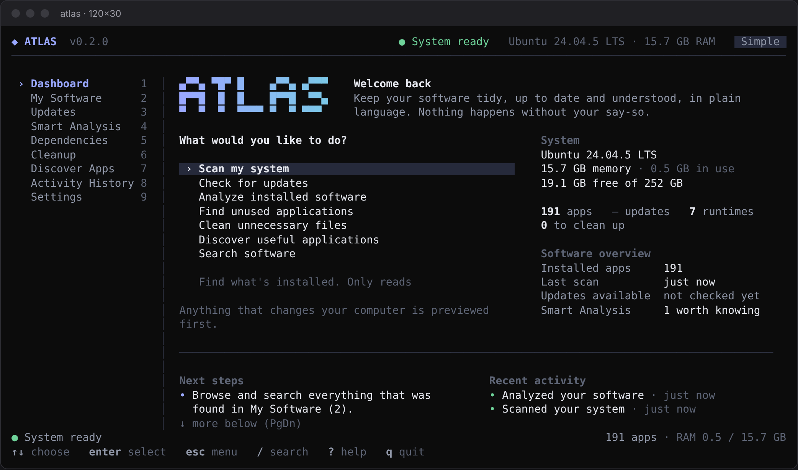
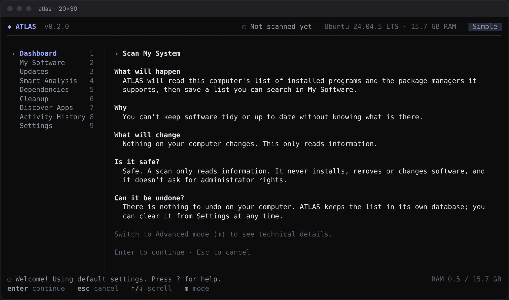
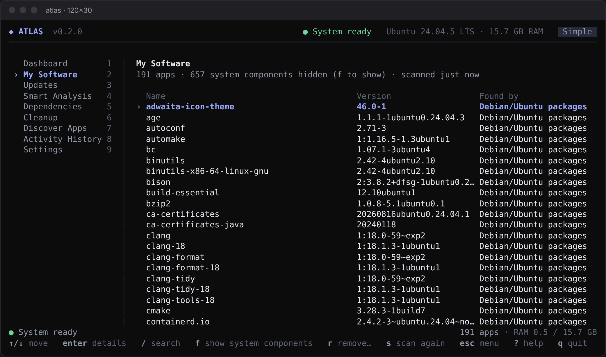
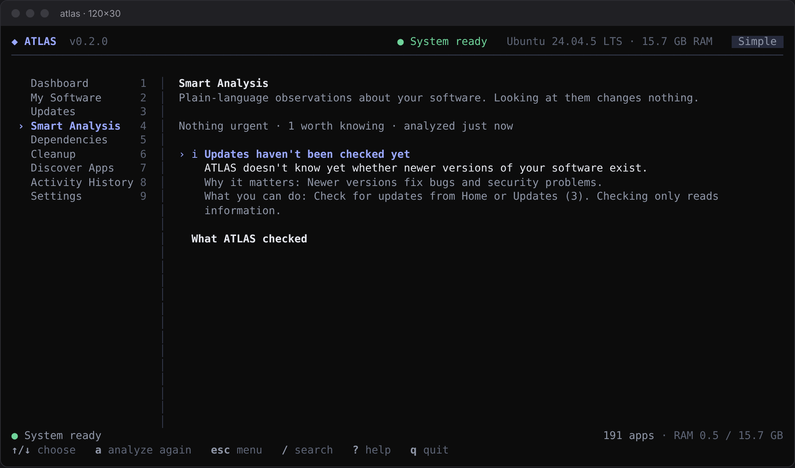
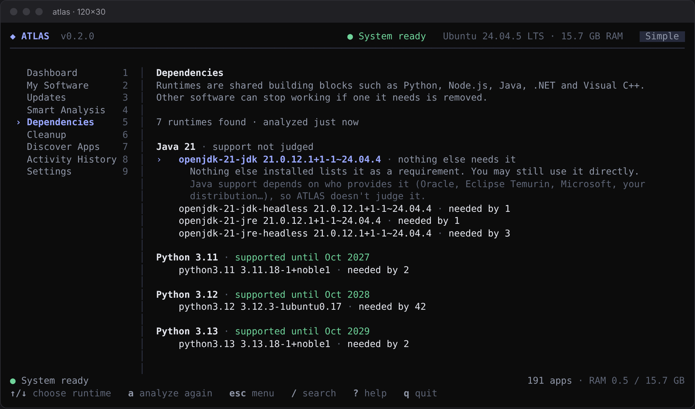

<div align="center">

# ◆ ATLAS

### Application & Tool Lifecycle Analysis System

**See everything installed on your computer, keep it up to date, and clean it up safely,
in plain language, from your terminal.**

[](https://github.com/Deepakraj1207/atlas/releases/latest)
[](https://github.com/Deepakraj1207/atlas/actions/workflows/windows.yml)
[](https://github.com/Deepakraj1207/atlas/actions/workflows/linux.yml)

[](LICENSE)



[🚀 Install](#-install) · [🧭 First steps](#-first-steps) · [🧩 Features](#-features) · [⌨️ Keys](#️-keyboard) · [❓ Help](#-troubleshooting)

</div>

---

## ✨ Why ATLAS

- 🗣️ **Plain language.** No jargon: every screen says what something is, why it matters
  and what you can do about it.
- 👀 **A preview before every change.** ATLAS shows exactly what will happen, why, whether
  it's safe and whether it can be undone. Nothing runs until you confirm.
- 🔒 **Nothing happens silently.** Every scan, update and removal is recorded in Activity
  History, and ATLAS never answers a package manager's questions for you.
- ⌨️ **Keyboard-first, fast and light.** One small program, no background service, no
  account. Works in Windows Terminal, PowerShell and any Linux terminal.

> 🪟 **Built for Windows 11 first; Linux is fully supported.** ATLAS understands winget,
> Chocolatey, Scoop and Windows' own list of installed programs, and on Linux apt/dpkg,
> DNF, Zypper, RPM, Snap and Flatpak.

---

## 📑 Contents

- [🚀 Install](#-install) · [🔄 Update](#-update) · [🗑️ Uninstall](#️-uninstall)
- [🧭 First steps](#-first-steps)
- [🧩 Features](#-features)
- [🛡️ Safety promises](#️-safety-promises)
- [⌨️ Keyboard](#️-keyboard)
- [🤖 AI explanations (optional)](#-ai-explanations-optional)
- [⚙️ Settings and files](#️-settings-and-files)
- [❓ Troubleshooting](#-troubleshooting)
- [🛠️ Build from source](#️-build-from-source)

---

## 🚀 Install

One command. No administrator rights, no sudo.

### 🪟 Windows

Open **PowerShell** or **Windows Terminal** and run:

```powershell
irm https://raw.githubusercontent.com/Deepakraj1207/atlas/main/install.ps1 | iex
```

### 🐧 Linux

Open a terminal and run:

```sh
curl -fsSL https://raw.githubusercontent.com/Deepakraj1207/atlas/main/install.sh | sh
```

Then start ATLAS by typing:

```sh
atlas
```

<details>
<summary><b>🔍 What does the installer do?</b></summary>

1. 📡 Finds the latest ATLAS release on GitHub.
2. 💻 Downloads the right file for your computer (x64 or ARM64).
3. ✅ Checks it against the release's `SHA256SUMS` and stops if anything doesn't match.
4. 📁 Installs `atlas` for your user only:
   - **Windows:** `%LOCALAPPDATA%\Programs\ATLAS`, added to your PATH.
   - **Linux:** `~/.local/bin`. If that folder isn't on your PATH, the installer shows
     the one line to add.
5. 🚫 Changes nothing else: no administrator rights, no services, no background updates.

Prefer to read the script first? Open the URL in your browser, or download it and run it
as a file.

</details>

<details>
<summary><b>📦 Other ways to install</b></summary>

Every [release](https://github.com/Deepakraj1207/atlas/releases/latest) has these files:

| System | File | How |
|---|---|---|
| 🪟 Windows | `atlas_<version>_windows_amd64.zip` (or `_arm64`) | Unzip and run `atlas.exe` in Windows Terminal |
| 🐧 Ubuntu / Debian | `atlas-lifecycle_<version>_amd64.deb` | `sudo apt install ./atlas-lifecycle_<version>_amd64.deb` |
| 🐧 Fedora / RHEL | `atlas-lifecycle-<version>-1.x86_64.rpm` | `sudo dnf install ./atlas-lifecycle-<version>-1.x86_64.rpm` |
| 🐧 openSUSE | `atlas-lifecycle-<version>-1.x86_64.rpm` | `sudo zypper install ./atlas-lifecycle-<version>-1.x86_64.rpm` |
| 🐧 Any Linux | `atlas_<version>_linux_amd64.tar.gz` | Unpack and run `./atlas` |

Check downloads with `SHA256SUMS`. The Linux package is called `atlas-lifecycle`
because Fedora already has an unrelated package named `atlas`; the command is still
`atlas`.

</details>

### 🔄 Update

Run the **same install command again**. It replaces ATLAS with the latest release and
keeps your settings and saved data. ATLAS never updates itself in the background.

### 🗑️ Uninstall

🪟 **Windows** (PowerShell):

```powershell
$env:ATLAS_UNINSTALL='1'; irm https://raw.githubusercontent.com/Deepakraj1207/atlas/main/install.ps1 | iex
```

🐧 **Linux:**

```sh
curl -fsSL https://raw.githubusercontent.com/Deepakraj1207/atlas/main/install.sh | ATLAS_UNINSTALL=1 sh
```

This removes the program (and on Windows its PATH entry). Your settings and saved data
are kept; [delete their folders](#️-settings-and-files) too if you want them gone.

---

## 🧭 First steps

### 1️⃣ Start ATLAS

Type `atlas`. You land on the **Dashboard**: a list of the common jobs, your computer
at a glance, and what to do next. Use **↑ ↓** to choose and **Enter** to select.

### 2️⃣ Scan your system

Choose **Scan my system**. Like every action, it first shows a **preview** of exactly
what will happen. Press **Enter** to go ahead or **Esc** to cancel. A scan only reads
information and takes a few seconds.



### 3️⃣ Browse and search your software

Press **2** for **My Software**: everything that was found, in one list. Press **/** to
search (from any screen), **Enter** for details, and **f** to also show libraries and
system components.



### 4️⃣ Check for updates

Choose **Check for updates** on the Dashboard, or press **3**. ATLAS asks your package
managers which software has newer versions. In **Updates**, press **u** to update
everything, or **Space** to pick some and **Enter** to update those. Updates run in your
terminal through the package manager itself, so you see its real output.

### 5️⃣ Get plain-language insight

Choose **Analyze installed software** (or press **4**, then **Enter** or **a**). **Smart
Analysis** points out what's worth knowing: runtimes that no longer get security fixes,
apps installed twice, old versions, and apps you haven't opened in a year (Windows). It
also lists what it checked, and what it couldn't check.



Press **5** for **Dependencies**: which runtimes (Python, Node.js, Java, .NET, Visual
C++) other software needs, and whether they're still supported.



### 6️⃣ Clean up safely

Press **6** for **Cleanup**: remove software you don't need and clear package caches and
old versions. Before any removal ATLAS checks again what depends on it, and refuses to
remove anything other software or your system needs. Deletions need the **r** key; Enter
alone never deletes anything.

### 7️⃣ Discover useful tools

Press **7** for **Discover Apps**: free, well-known tools that fit what you already use,
with the reason for each suggestion. Suggestions are built from your own software list,
with no internet lookups.

> 💡 Press **?** on any screen to see its keys. Press **m** for **Advanced mode** (package
> IDs, paths and the exact commands) and **t** for the light theme.

<sub>Screenshots: ATLAS 0.2.0 at 120×30 on Ubuntu. On Windows it shows your Windows
version and your Windows apps.</sub>

---

## 🧩 Features

| | Feature | What it does |
|---|---|---|
| 🏠 | **Dashboard** | What would you like to do?, your computer at a glance (system, memory, disk), real counts of apps, updates, runtimes and things to clean up, and next steps |
| 🔍 | **Scan My System** | Finds installed software without changing anything. Windows: installed programs, winget, Chocolatey, Scoop. Linux: dpkg/apt, RPM, Snap, Flatpak |
| 📋 | **My Software** | Searchable list with details; libraries and runtimes are hidden unless you ask |
| ⬆️ | **Updates** | Checks winget, Chocolatey and Scoop (Windows), and APT, DNF or Zypper, Snap and Flatpak (Linux). Update all, or pick. Only what the computer confirms counts as updated |
| 🧠 | **Smart Analysis** | Plain-language observations: unsupported runtimes, duplicates, old versions, unused apps |
| 🔗 | **Dependencies** | Which software needs which runtime, from your package managers' own records |
| 🧹 | **Cleanup** | Removes software and clears caches, after re-checking dependencies; refuses when it can't be sure |
| 🎁 | **Discover Apps** | Suggests free tools that fit what you use, and installs them after a preview |
| 📜 | **Activity History** | A record of everything ATLAS has done |
| 🤖 | **AI explanations** | Optional, off by default: ask an AI to explain an app or a finding ([details](#-ai-explanations-optional)) |
| 🎨 | **Comfort** | Simple and Advanced modes, dark and light themes, help on every screen, works from 40×10 up |

---

## 🛡️ Safety promises

- ✅ ATLAS changes your computer **only** to install updates or tools you picked, remove
  software, or clear caches, and **only after you confirm a preview** that lists every
  change.
- ✅ Removals and clean-ups need the **r** key. Enter alone never deletes anything.
- ✅ Package managers run in your terminal, so **you** answer their prompts (your sudo
  password, a Windows permission dialog). ATLAS never answers for you, and never accepts
  agreements on your behalf.
- ✅ No `-y`, purge, force or delete-data flags, ever. Your settings and data in other
  apps are kept.
- ✅ After a removal or update, ATLAS checks the computer again. Anything it can't
  confirm stays listed.
- ✅ Every action is recorded in **Activity History** (press **8**).

---

## ⌨️ Keyboard

| Key | Action |
|---|---|
| `↑` `↓` · `Enter` | Move through the list on screen · choose |
| `Esc` | Back: close what's open, then move to the section list (`↑` `↓`, `Enter` to open) |
| `1`–`9` · `Tab` | Jump to a section · next section |
| `/` | Search your software, from anywhere |
| `?` | Help for the current screen |
| `m` · `t` | Simple / Advanced mode · dark / light theme (both remembered) |
| `PgUp` `PgDn` | Scroll when a screen doesn't fit |
| `x` | Stop a running scan, check or analysis (nothing is changed) |
| `q` | Quit |

<details>
<summary><b>Keys on each screen</b></summary>

| Screen | Keys |
|---|---|
| 📋 My Software | `/` search · `Enter` details · `f` show system components · `r` remove (with a preview) · `s` scan again |
| ⬆️ Updates | `c` check · `u` update all · `Space` select · `Enter` update selected · `a` select all/none · `f` system components |
| 🧠 Smart Analysis · 🔗 Dependencies | `Enter` or `a` analyze · `↑` `↓` choose · `e` explain (AI, when on) |
| 🧹 Cleanup | `c` look for things to tidy · `Space` select · `Enter` review · `a` analyze |
| 🎁 Discover Apps | `←` `→` category · `Space` select · `Enter` install (with a preview) |
| 👀 A preview | `Enter` go ahead · `r` go ahead with a removal · `Esc` cancel · `m` show technical details |
| ⏳ While updates run | `Ctrl+C` stop; nothing further starts |

</details>

---

## 🤖 AI explanations (optional)

Off by default. When on, press **e** on a finding or an app to ask an AI what it is and
whether it matters. You always see **exactly what will be sent** first, and your user
name, home folder and computer name are removed. Answers are advice only: ATLAS never
runs anything they suggest.

| | ☁️ Claude (Anthropic) | 🏠 Ollama (local) |
|---|---|---|
| Where it runs | Anthropic's servers | Your own computer |
| Cost | Billed to **your Anthropic API account** by the token (a Claude.ai subscription doesn't cover it); the preview shows the most one question can cost | Free |
| Needs | `ANTHROPIC_API_KEY`, or `ant auth login` | [Ollama](https://ollama.com) and a model (`ollama pull llama3.2`) |

Turn it on in **Settings** (press **9**), or in the settings file:

```yaml
ai:
  enabled: true
  provider: ollama          # or anthropic (the default)
  model: llama3.2           # for Ollama: a model you've pulled
  # ollama_url: http://localhost:11434
  # max_output_tokens: 4096 # answer length limit, 1024–16000
```

---

## ⚙️ Settings and files

| | 🪟 Windows | 🐧 Linux |
|---|---|---|
| ⚙️ Settings | `%AppData%\atlas\config.yaml` | `~/.config/atlas/config.yaml` |
| 🗄️ Saved data | `%LocalAppData%\atlas\atlas.db` | `~/.local/share/atlas/atlas.db` |
| 📝 Log | `%LocalAppData%\atlas\logs\atlas.log` | `~/.local/state/atlas/logs/atlas.log` |

**Command-line options**

| Option | What it does |
|---|---|
| `atlas -version` | Print the version, commit and build date |
| `atlas -selftest [-report file.md]` | Check ATLAS against this computer and optionally write a report. Read-only; doesn't touch your ATLAS data |
| `atlas -config <path>` | Use a specific settings file |
| `ATLAS_HOME=<folder>` | Keep settings, data and logs in one folder (portable use) |

---

## ❓ Troubleshooting

<details>
<summary><b>"atlas" isn't recognised after installing</b></summary>

Open a **new** terminal window: the installer adds ATLAS to your PATH, and terminals that
were already open don't see the change. On Linux, if the installer said `~/.local/bin`
isn't on your PATH, run the line it showed, then open a new terminal.

</details>

<details>
<summary><b>Updates says winget is waiting for its agreements</b></summary>

winget asks you to accept its source agreements once. Open a terminal, run
`winget list`, answer the question, then check again in ATLAS. ATLAS never accepts
agreements for you.

</details>

<details>
<summary><b>Windows SmartScreen warns about atlas.exe</b></summary>

ATLAS isn't code-signed yet, so SmartScreen may warn about an `atlas.exe` downloaded with
a web browser. Choose **More info → Run anyway** if you trust the download. You can check
the file against `SHA256SUMS` from the release first.

</details>

<details>
<summary><b>Another "atlas" command starts instead</b></summary>

The MongoDB Atlas CLI also installs a command called `atlas`; whichever comes first on
your PATH wins. The installer warns when it sees another one. Run ATLAS by its full path,
or remove the other one.

</details>

<details>
<summary><b>Something looks wrong</b></summary>

Run `atlas -selftest -report atlas-report.md` and open an
[issue](https://github.com/Deepakraj1207/atlas/issues) with the report attached. The
report is read-only and changes nothing. It lists what ATLAS could read on your computer,
including the names of installed software and folder paths that contain your user name,
so read it before sharing and remove anything you'd rather keep private.

</details>

---

## 🛠️ Build from source

ATLAS needs **Go 1.27.4** (the version in `go.mod`).

```sh
git clone https://github.com/Deepakraj1207/atlas.git
cd atlas
go build -o atlas ./cmd/atlas     # Windows: go build -o atlas.exe ./cmd/atlas
./atlas
```

Checks before a change:

```sh
export GOTOOLCHAIN=local
gofmt -l . && go vet ./... && go test ./...
GOOS=windows GOARCH=amd64 CGO_ENABLED=0 go build ./cmd/atlas
```

📚 More: [`PROJECT_STATE.md`](PROJECT_STATE.md) (status) · [`DECISIONS.md`](DECISIONS.md)
(why things are the way they are) · [`TEST_STATUS.md`](TEST_STATUS.md) (what's tested) ·
[`docs/RELEASING.md`](docs/RELEASING.md) (making a release).

---

<div align="center">

📄 [MIT licence](LICENSE) · Made for people who want to understand their computer.

</div>
